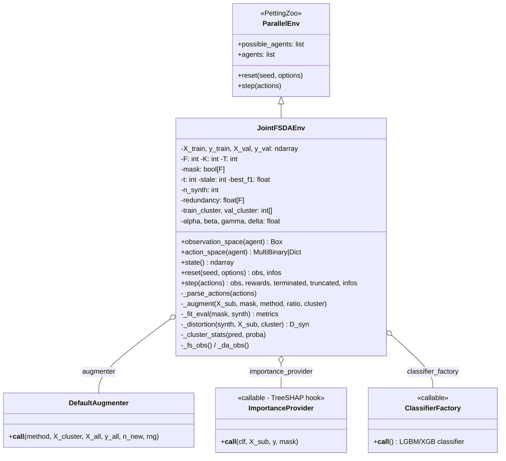
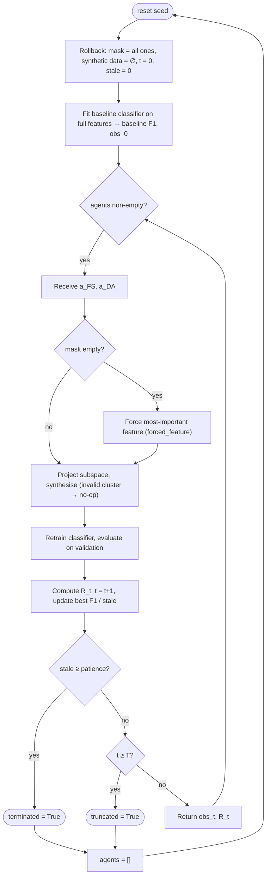

# Ahmed Sabry — Assigned Diagrams (Mermaid)

## 1. UML Class Diagram — JointFSDAEnv


## 2. UML Sequence Diagram — agent–env–classifier loop (one step)
```mermaid
sequenceDiagram
    participant FS as π_FS (fs_agent)
    participant DA as π_DA (da_agent)
    participant E as JointFSDAEnv
    participant C as LightGBM/XGBoost
    participant X as Importance (TreeSHAP) hook
    FS->>E: a_FS (binary mask)
    DA->>E: a_DA (method, ratio, cluster)
    E->>E: _parse_actions (clip ratio, repair empty mask)
    E->>E: project X_train onto mask
    E->>E: _augment in subspace (target cluster)
    E->>C: fit(train ∪ synthetic)
    C-->>E: fitted model
    E->>C: predict_proba(X_val[:, mask])
    C-->>E: proba → Macro-F1, G-Mean, PR-AUC
    E->>X: importance(clf, X_sub, y, mask)
    X-->>E: global importance vector
    E->>E: _distortion → D_syn; compute R_t
    E-->>FS: obs_FS, R_t, term/trunc, info
    E-->>DA: obs_DA, R_t, term/trunc, info
```

## 3. MDP State-Transition & Reward Architecture

```mermaid
flowchart LR
    subgraph S["State s_t (critic) = fs_obs ⊕ da_obs"]
        direction TB
        s1["mask m_t (F)"]
        s2["global importance (F)"]
        s3["redundancy (F)"]
        s4["cluster stats: miss-rate, density, uncertainty (3K)"]
        s5["minority ratio, synth fraction, t/T, F1, G-Mean"]
    end
    S -->|o_FS| AFS["π_FS → a_FS ∈ {0,1}^F"]
    S -->|o_DA| ADA["π_DA → a_DA = (method, ratio, cluster)"]
    AFS --> T["Transition: project subspace → synthesise → retrain classifier → evaluate on validation"]
    ADA --> T
    T --> S2["s_{t+1}"]
    T --> R["R_t (shared)"]
    subgraph RW["R_t = α·ΔF1 + β·GMean − γ·F_sel/F_tot − δ·D_syn"]
        direction TB
        r1["+ α·ΔF1_macro (improvement)"]
        r2["+ β·G-Mean (balanced recall)"]
        r3["− γ·F_sel/F_tot (feature cost)"]
        r4["− δ·D_syn (distribution distortion)"]
    end
    R --- RW
```


## 4. Episode Lifecycle Flowchart

